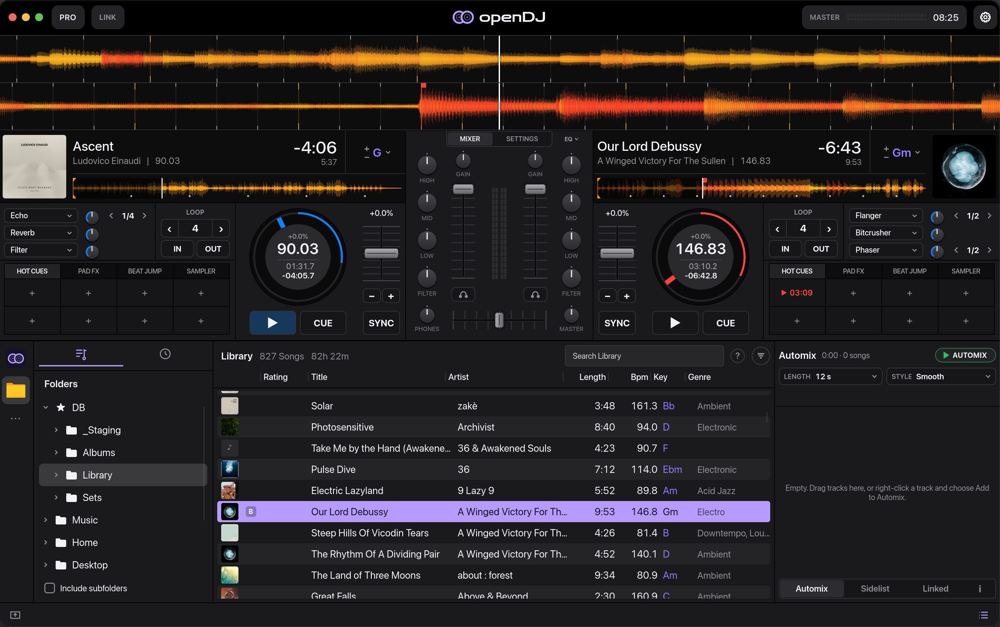

# openDJ

**[Download the latest release](https://github.com/sebastian-beca/opendj/releases/latest)** · [All releases](https://github.com/sebastian-beca/opendj/releases)

openDJ is a free, open-source DJ app for macOS and Linux. It's built to be fast,
pleasant to use, and to have a great automix, for DJs just starting out and for
more experienced DJs alike.



## Features

- **Two decks** with hot cues, loops, beat jumps, sync, quantize, key lock and key shift
- **Mixer** with gain, 3-band EQ, filter, faders, crossfader and headphone cue
- **Effects**: four beat-synced effect units, with echo, reverb, filter, flanger and more
- **Automix** that crossfades through a list for you, in several lengths and styles
- **Library** of your music folder, with playlists, smart lists, ratings, colours,
  play history and fast search
- **Accurate beat grids** that follow tempo changes, with tools to fix them by hand
- **Key detection** and harmonic mixing hints
- **Stems**: play NI stem files, or split any track with Demucs if it's installed
- **Ableton Link** to play in time with other apps and devices on your network
- **Fast GPU waveforms**, coloured by frequency

## Controllers

openDJ uses [Mixxx](https://mixxx.org)'s controller mappings, so most MIDI
controllers that Mixxx supports work as soon as they're plugged in. HID
controllers aren't supported yet.

## Streaming services and stores

Streaming services and music stores are coming soon, we hope as library add-ons.
For now, openDJ plays the music on your computer.

## Beta testing

openDJ is in beta, and feedback of any kind helps: bugs, ideas, or just how
it felt to use. In the app, **Settings → Feedback** has links to report a
problem or suggest a feature, with your version already filled in, and opens
the folder with your logs to attach. You can also
[open an issue](https://github.com/sebastian-beca/opendj/issues/new/choose)
directly.

## Building from source

Needs a recent stable Rust, CMake and a C++ compiler. On Linux you also need:

```sh
sudo apt install cmake libfontconfig-dev libxkbcommon-dev libasound2-dev libclang-dev
```

Then:

```sh
cargo run --release
```

openDJ reads your `~/Music` folder. Set `OPENDJ_MUSIC=/path/to/music` to use another one.

## Thanks to Mixxx

openDJ draws on [Mixxx](https://mixxx.org) for controller compatibility and much
of its inspiration. It is a separate project, not affiliated with or endorsed by
Mixxx.

## Licence

openDJ's source is GPL-2.0-or-later. Built copies are distributed under GPL-3.0,
because the app uses [Slint](https://slint.dev). See [LICENSE](LICENSE) and
[NOTICE](NOTICE). To report a security problem, see [SECURITY.md](SECURITY.md).
