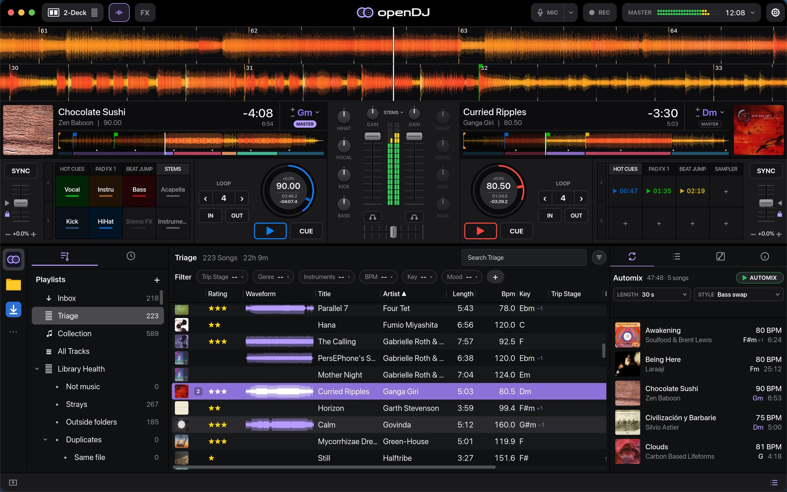

# openDJ

**[Download the latest release](https://github.com/openwave-studio/opendj/releases/latest)** · [All releases](https://github.com/openwave-studio/opendj/releases)

openDJ is a free, open-source DJ app for macOS, Linux and Windows (preview).
It's built to be fast, pleasant to use, and to have a great automix, for DJs
just starting out and for more experienced DJs alike.



## Features

- **Decks**: two or four, with hot cues, loops, beat jumps, slip, sync, key lock,
  key shift and a beat and phrase counter; 2-Deck, 2-Deck Pro, 4-Deck and Player layouts
- **Mixer and effects**: gain, 3-band EQ, Color FX on the filter knob, and an FX bar
  of beat-locked effects, plus your own CLAP, VST3 and Audio Unit plugins
- **Stems** on every track: instant stems on load, high quality ones in the background
- **Automix** that mixes through a list for you, run from the app or from your phone
- **Collection** of your music folders with stages (Inbox, In Prep, Play Ready),
  crates, playlists, smart lists, tag groups, batch editing and forgiving search
- **Collection Health** to find missing files, duplicates and poor tags, and fix them
- **Imports** from rekordbox, VirtualDJ, Traktor and Mixxx, keeping your cues, grids and lists,
  plus M3U8, PLS and XSPF playlist files in and out
- **Sources**: browse Spotify and other streaming services, play from your own Plex,
  Navidrome or Jellyfin server
- **Sampler, Groove Box** drum machine and instrument plugins on the decks
- **Recording and broadcasting**: record your mix, export it for Mixcloud, or stream to
  Icecast and Shoutcast with a loudness meter, with a now-playing overlay for OBS
- **Ableton Link**, fast GPU waveforms, accurate beat grids and key detection
- **Tutorials** inside the app, and a [user guide](https://opendj.app/docs/)

## Controllers

openDJ uses [Mixxx](https://mixxx.org)'s controller mappings, so most MIDI
controllers that Mixxx supports work as soon as they're plugged in, and
ships its own mappings for some (DDJ-FLX6, XDJ-RX3, Xone K2). USB HID
controllers with a Mixxx HID mapping work too: Native Instruments' Traktor
Kontrol S2 (MK1 to MK3), S3, S4 (MK2, MK3), F1, Z1 and MX2. Quit Traktor
first; on Linux, the .deb and .rpm set up the USB permissions, or add the
udev rule that comes with the other downloads. The Controller Editor maps
anything else, with a wizard for controllers that have no mapping.

## Streaming services and stores

Spotify, TIDAL, Apple Music, SoundCloud and Mixcloud can be browsed, and
tracks you have as files play from your collection. Streaming services
can't be played on the decks, and stores are coming later.

## Beta testing

openDJ is in beta, and feedback of any kind helps: bugs, ideas, or just how
it felt to use. In the app, **Settings › Help** has links to report a
problem or suggest a feature, with your version already filled in, and opens
the folder with your logs to attach. You can also
[open an issue](https://github.com/openwave-studio/opendj/issues/new/choose)
directly.

What testers get:

- **Credit.** Everyone whose report or idea makes it into a release is thanked
  by name in its release notes and listed below.
- **A vote.** Give a 👍 to the
  [feature requests](https://github.com/openwave-studio/opendj/issues?q=is%3Aissue+is%3Aopen+label%3Aenhancement+sort%3Areactions-%2B1-desc)
  you want most; the most wanted are built first.
- **Your controller first.** If your controller doesn't work right,
  [tell us which one](https://github.com/openwave-studio/opendj/issues/new?template=controller.yml)
  and testers' controllers are fixed before anything else.
- **Early builds.** Test builds come out as
  [pre-releases](https://github.com/openwave-studio/opendj/releases) before
  each version. Watch the repository (Watch → Custom → Releases) to hear
  about them.

### Beta testers

Thank you to everyone who has helped test openDJ:

- *Your name here: send a report or an idea.*

## Building from source

Needs a recent stable Rust, CMake and a C++ compiler. On Linux you also need:

```sh
sudo apt install cmake libfontconfig-dev libxkbcommon-dev libasound2-dev libudev-dev libclang-dev
```

Then:

```sh
cargo run --release
```

openDJ reads your `~/Music` folder. Set `OPENDJ_MUSIC=/path/to/music` to use another one.

## Thanks to Mixxx

openDJ draws on [Mixxx](https://mixxx.org) for controller compatibility and much
of its inspiration. It is a separate project, not affiliated with or endorsed by
Mixxx.

## Licence

openDJ's source is GPL-2.0-or-later. Built copies are distributed under GPL-3.0,
because the app uses [Slint](https://slint.dev). See [LICENSE](LICENSE) and
[NOTICE](NOTICE). To report a security problem, see [SECURITY.md](SECURITY.md).
