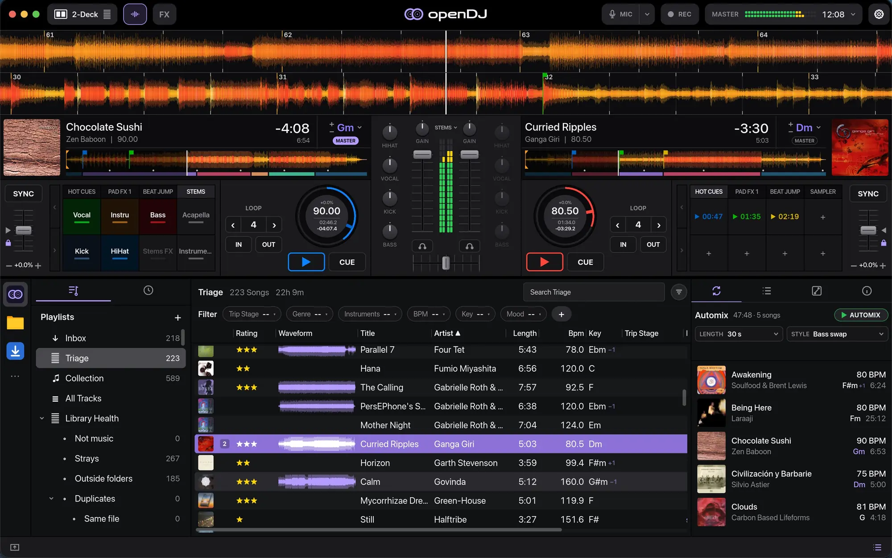

# openDJ

openDJ is a free, open-source DJ app for macOS, Linux and Windows, built in Rust. It's
made to be fast, pleasant to use, and to have a great Automix, for DJs just
starting out and for experienced DJs alike.

These docs cover openDJ 0.4. They have two parts:

- The **user guide** covers installing openDJ, loading your music and
  everything on screen, from the decks to Automix and controllers. Start with
  [Install](guide/install.md).
- The **developer guide** covers building openDJ from source.

## Where to start

- **New to openDJ?** [Install](guide/install.md) it, add your music in
  [Your library](guide/music.md), then learn the [decks and mixer](guide/decks.md).
- **Coming from VirtualDJ?** [Bring in your library](guide/music.md#bringing-in-a-virtualdj-library):
  cues, grids, lists and history come across.
- **Tidying a big collection?** [Stages](guide/music.md#stages-inbox-triage-and-collection),
  [crates and sets](guide/music.md#crates-and-sets) and
  [Library Health](guide/library-health.md).
- **Mixing:** [Pads](guide/pads.md), [Looping](guide/looping.md),
  [Effects](guide/fx.md), [Stems](guide/stems.md) and [Automix](guide/automix.md).
- **Got a DDJ-FLX4?** See its [own page](guide/controllers/ddj-flx4.md).

openDJ also has short tutorials on the [website](https://opendj.app/tutorials/).

openDJ is in beta. If something here is wrong or missing, use **Suggest an
edit** at the top of any page, or
[open an issue](https://github.com/sebastian-beca/opendj/issues/new/choose).
